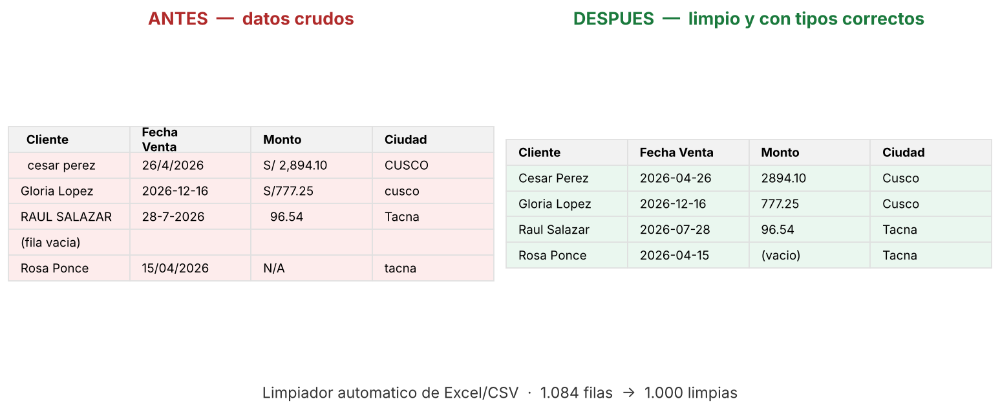

# Limpiador automático de Excel / CSV

Herramienta en Python que toma una hoja de cálculo **desordenada** y devuelve
una versión **limpia y lista para usar**, junto con un reporte de todo lo que
se corrigió. Pensada para despachos contables, tiendas, administradores y
cualquiera que reciba datos sucios y necesite ordenarlos sin hacerlo a mano.

No es un script de juguete: maneja los problemas reales que aparecen en
archivos de verdad.

## Qué resuelve

A partir de un `.xlsx`, `.xls` o `.csv` el programa:

- **Detecta el encabezado real** aunque haya títulos o filas en blanco antes de
  la tabla (el típico "REPORTE DE VENTAS" en la primera fila).
- **Normaliza los nombres de columna**: quita espacios, saltos de línea y
  renombra las columnas duplicadas o sin nombre.
- **Elimina filas y columnas completamente vacías.**
- **Recorta espacios** sobrantes al inicio y fin de cada celda de texto.
- **Unifica los valores vacíos**: `N/A`, `-`, `null`, `s/d`, etc. pasan a ser
  celdas vacías reales.
- **Convierte a número** las columnas que vienen como texto, incluso con
  símbolo de moneda y separador de miles (`S/ 1,250.50` → `1250.50`).
- **Convierte a fecha** las columnas de fechas, aceptando varios formatos
  mezclados en la misma columna (`15/01/2026`, `2026-01-16`, `17-01-2026`).
- **Estandariza mayúsculas** en el texto: unifica variantes de una misma
  palabra (`CUSCO`, `cusco`, `Cusco` → `Cusco`) sin romper acrónimos como
  `Disco SSD`.
- **Elimina filas duplicadas.**
- Genera un **reporte** (`.txt`) que explica cada cambio aplicado.

## Instalación

Requiere Python 3.9 o superior.

```bash
pip install -r requirements.txt
```

## Uso

```bash
# Limpieza básica: genera "ventas_limpio.xlsx" y su reporte
python limpiar_excel.py ventas.xlsx

# Indicar un archivo de salida
python limpiar_excel.py ventas.xlsx -o resultado.xlsx

# Elegir una hoja específica de un Excel
python limpiar_excel.py ventas.xlsx --hoja "Enero"

# Conservar las filas duplicadas (no eliminarlas)
python limpiar_excel.py ventas.xlsx --con-duplicados
```

El archivo limpio se guarda como `<nombre>_limpio.xlsx` si no se indica `-o`,
y al lado se escribe un reporte `<nombre>_limpio_reporte.txt`.

## Ejemplo real

El repositorio incluye un archivo de prueba realista: una base de **ventas de
1.085 registros** con el desorden típico de un negocio (fechas en cuatro
formatos distintos, montos con y sin "S/", mayúsculas inconsistentes,
duplicados, filas vacías y correos faltantes), más filas de título antes de la
tabla.

**Así se ve al llegar (crudo):**

| REPORTE DE VENTAS 2026 - USO INTERNO | | | ... | |
|---|---|---|---|---|
| *(fila vacía)* | | | | |
| &nbsp;&nbsp;Cliente&nbsp; | DNI | Fecha↵Venta | ... | Correo |
| Cesar Perez | 27885257 | 26/4/2026 | ... | cesar.perez@mail.com |
| Gloria Lopez | 35303973 | 2026-12-16 | ... | S/777.25 → *(texto)* |
| raul salazar | 37583539 | 28/7/2026 | TECLADO | null |
| *(fila vacía)* | | | | |

**Resultado tras ejecutar la herramienta:** 1.000 filas limpias, con los tipos
de dato correctos (`DNI` e importes como número, `Fecha Venta` como fecha).



> 🔎 **Resultado comprobado:** el archivo limpio y su reporte están incluidos en
> el repositorio, en [`resultado/`](resultado) — puedes abrir
> [`ventas_limpio.xlsx`](resultado/ventas_limpio.xlsx) y
> [`ventas_limpio_reporte.txt`](resultado/ventas_limpio_reporte.txt)
> para verificar la salida real sin tener que ejecutar nada.

El reporte que acompaña la salida lo documenta todo:

```
Dimensiones originales (crudas): 1084 filas x 9 columnas
Fila de encabezado detectada: fila 4 del archivo.
  - Encabezados normalizados: ['Cliente', 'DNI', 'Fecha Venta', 'Producto',
    'Cantidad', 'Precio Unitario', 'Monto Total', 'Ciudad', 'Correo']
  - Se eliminaron 30 filas vacías y 0 columnas vacías.
  - Se recortaron espacios sobrantes en 929 celdas de texto.
  - Se marcaron como vacías 22 celdas con valores tipo 'N/A', '-', 'null'.
  - Columnas convertidas a número: ['DNI', 'Precio Unitario', 'Monto Total']
  - Columnas convertidas a fecha: ['Fecha Venta']
  - Se unificaron 525 celdas con variantes de mayúsculas/espacios
    (p. ej. 'CUSCO'/'cusco' → 'Cusco').
  - Se eliminaron 50 filas duplicadas.
Dimensiones finales (limpias): 1000 filas x 9 columnas
```

Puedes reproducir este ejemplo con el archivo incluido:

```bash
python limpiar_excel.py datos/ventas_sucio.xlsx
```

## Cómo está hecho

El código separa cada corrección en su propia función (`recortar_espacios`,
`convertir_numeros`, `convertir_fechas`, etc.), de modo que es fácil activar,
desactivar o ajustar cada paso. Las conversiones son **conservadoras**: una
columna solo se convierte a número o fecha si el 80% o más de sus valores
realmente lo son, para no dañar datos legítimos.

## Licencia

MIT. Úsalo, modifícalo y adáptalo libremente.
